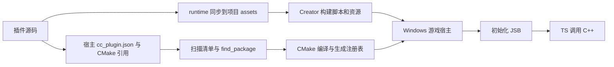

# 架构

工作台将 Creator 编辑器扩展、运行时 TS 和原生 C++ 组织为一个插件包，并使用选定游戏作为运行与调试宿主。独立源码可被多个宿主引用，各宿主分别保存启用状态、类型项目和构建缓存。原生编译和加载沿用 Cocos 的 `cc_plugin.json`、CMake 和 `CC_PLUGIN_ENTRY` 机制。

## 独立源码与宿主

独立插件的 `plugin-dev.json` 使用 schemaVersion 2，描述插件身份、模板和原生目标，不保存项目启用状态。宿主根目录的 `plugin-dev.host.json` 保存引用：

```json
{
  "schemaVersion": 1,
  "plugins": {
    "my-plugin": { "source": "../my-plugin", "enabled": true }
  }
}
```

`source` 相对宿主项目根目录解析；跨磁盘时使用绝对路径。此文件是项目配置，应纳入游戏版本管理。插件源码由自身仓库管理。本机指纹、日志、构建结果仍放在宿主的 `.plugin-dev` 内。

每个宿主在 `extensions/<name>` 生成独立接入目录，包含 Creator 扩展入口、原生清单及 Windows CMake 转发文件。转发文件包含原始源码的 `<target>-config.cmake`，因此编译器和原生调试信息使用原始 C++ 路径。原生清单的 `disabled` 只在宿主接入目录更新。

接入文件记录内容哈希。同步前检查文件归属和冲突，手工修改会明确报错。源码目录缺失、配置错误或监听失败同样报告错误。接入目录缺失时，同步可以根据项目引用重新生成；再次关联同一来源也会同步修复。运行时 TS 沿用受管同步，不通过目录联接或符号链接接入。

解除引用会关闭宿主 TS 开关、移除受管接入目录和项目引用，保留源码及已导入的资源 UUID。状态记录保留 `detached` 和待构建标记，防止直接启动仍包含旧原生模块的游戏。重新关联恢复同步；资源与原生构建完成后，才清除对应待构建标记。

原有 schemaVersion 1 内嵌插件继续使用项目 `extensions/<name>` 作为源码目录。独立源码发布时转换为可直接安装的内嵌格式，不携带宿主绝对路径。

## 构建与加载



| 配置或阶段 | 职责 |
| --- | --- |
| `package.json` | 声明编辑器入口和 `contributions.builder`，加载源码同步与 Windows 构建 hooks。 |
| `plugin-dev.json` | 保存插件名称、模板和目标；旧版内嵌格式还保存启用配置。 |
| `plugin-dev.host.json` | 保存当前游戏对独立源码的引用及启用配置。 |
| `cc_plugin.json` | 声明原生模块、目标平台和启用状态，供官方构建扫描。 |
| `<target>-config.cmake` | 通过 `add_subdirectory()` 编译插件源码，也可用于引入第三方库。 |
| `${ENGINE_NAME}` | 插件链接引擎目标，继承公开的头文件路径与编译定义。 |
| `plugin_registry` | 生成对 `cc_load_plugin_<target>()` 的调用，将插件入口链接进宿主。 |
| `CC_PLUGIN_ENTRY` | 定义原生初始化入口；首参数必须与 `modules[].target` 和 CMake target 一致。 |
| `AFTER_INIT` | 脚本引擎初始化后注册 JSB，随后游戏 TS 才能使用原生接口。 |

原生插件静态链接到游戏。启停会同时更新 TS 开关和原生清单，需要重新配置、构建并重启游戏后生效。编辑器扩展的卸载不等于卸载游戏中的原生代码。

相关引擎实现位于 `templates/cmake/common.cmake`、`native/cmake/scripts/plugins_parser.js`、`native/cocos/plugins/Plugins.h` 和 `native/cocos/application/BaseGame.cpp`。这些路径相对于 **Cocos 引擎仓库**；引擎源码不包含在本工具仓库中。

## 工具模块

| 模块 | 职责 |
| --- | --- |
| `main.js`、`panels/default/` | 编辑器菜单、面板、任务状态与日志。 |
| `cli.cjs` | 与面板共用核心函数的命令行入口。 |
| `lib/core.cjs` | 生成插件、安装工作台、管理插件和打包。 |
| `lib/binary-package.cjs` | 根据成功构建记录与 CMake 元数据收集二进制发布内容，生成配置及 ABI 校验信息。 |
| `lib/package-archive.cjs` | 通过成熟 ZIP 库流式写入发布归档。 |
| `lib/windows.cjs` | 探测工具链、准备宿主、配置与构建 C++、生成调试工作区。 |
| `lib/run-log.cjs` | 按文件位置增量读取游戏日志，保存跨读取块的 UTF-8 字符并限制单次读取量。 |
| `lib/dev-host.cjs` | 生成独立测试场景和启动组件，检查原生注册并自动运行插件探针。 |
| `lib/ide.cjs` | 配置 VS Code 的 CMake Tools / clangd，选择匹配 Visual Studio 的 CMake 并生成独立 `.sln` / `.slnx`。 |
| `templates/common/editor/plugin-support.cjs` | 同步运行时文件、检测冲突、记录变更和启停状态；随生成的插件分发。 |
| `templates/common/editor/typescript-plugin.cjs` | 通过 TypeScript `getExternalFiles` 为原始源码项目加载当前宿主的声明。 |
| `templates/common/editor/runtime-deployment.cjs` | 校验运行资源归属、内容冲突和部署目录，执行复制及清理。 |
| `templates/common/editor/builder.js`、`build-hooks.cjs` | 接入 Creator 构建阶段，同步 TS、配置 CMake 部署入口并检查构建结果。 |
| `templates/common/editor/windows-build.cmake`、`runtime-build.cmake` | 选择匹配配置的 V8 DLL，在宿主可执行目标和默认目标构建时执行部署。 |

耗时操作先返回任务编号，面板再读取日志和完成状态。面板在原生构建期间禁用其他写入操作。构建过程中发生的新修改保留为待构建状态。

取消请求通过 `AbortSignal` 传递到构建流程。任务在子进程退出前保持锁定，取消完成后才恢复操作。Creator 编辑器内的资源构建等待当前阶段结束后停止后续步骤。

游戏进程按项目记录 PID、启动时间和可执行文件路径，停止前重新核对身份。运行、停止和重启使用跨进程锁；构建前停止工具管理的游戏实例。其他工具启动的进程不由工作台接管。

游戏 stdout 与 stderr 写入 `.plugin-dev/logs/runtime.log`，启动记录保存本次输出的起始位置。面板通过独立的 `get-runtime-log` 请求持续读取，构建任务结束后仍可显示游戏输出。每次最多读取 64 KiB，历史预览与面板文本均限制长度；关闭面板停止轮询，游戏继续运行。进程结束后读取剩余内容，文件读取错误直接显示在面板中。操作结果仅显示必要状态、提示与输出路径。

工作台的 CMake 配置向宿主可执行目标加入 `lib/cmake/runtime-log.cpp`；工作台启动游戏时通过 `CPD_RUNTIME_LOG=1` 启用。宿主在启动阶段将 CRT 的 `LC_CTYPE` 设为 UTF-8，每 200 毫秒批量刷新 stdout/stderr，正常退出时完成最后一次刷新。该文件独立于插件静态库。Windows UCRT 的 `wprintf` 对 emoji 等代理对字符存在输出限制，面板保留日志文件中的原始内容。

## 源码与构建状态

插件的编辑入口是源码目录中的 `runtime` 和 `native/src`；独立源码可以位于游戏项目之外。运行时 TS 自动同步到宿主 `assets/__plugin_dev/<name>`，由 Creator 导入和打包。同步保留已有 `.meta` 和 UUID；目标文件被手动修改时报告冲突。

C++ 直接参与宿主的 CMake 构建。新增源文件需加入插件的 `CMakeLists.txt`。插件模板引入 `native/third_party/{include,lib,CMakeLists.txt}`，并在构建宿主时将已启用插件的 `native/third_party/bin`、`native/windows/bin` 及 `plugin-dev.json#runtimeFiles` 部署到宿主可执行文件目录。运行文件声明和内容纳入 `nativeFingerprint`；TS、启停和资源变化需要更新 Creator 构建资源。

本机配置、文件指纹、日志及构建缓存保存在项目 `.plugin-dev` 中。工作台与 VS Code 的 Ninja 缓存使用 `.plugin-dev/build/windows`；Visual Studio 解决方案使用 `.plugin-dev/build/visual-studio`，两种生成器不复用缓存。调试配置写入宿主的独立工作区。

首次构建自动生成 `assets/__plugin_dev_host/` 测试场景，明确传入 Creator 的 `scenes` 与 `startScene`，不依赖当前编辑场景。启动组件先检查启用插件的原生类，再挂载插件已有的 `PluginProbe.ts`。场景和脚本 UUID 持久化在 `.plugin-dev/dev-host.json`，重复生成保留 UUID 与 Creator 导入元数据；生成内容发生手工修改时明确报告冲突。

`Debug` 和 `RelWithDebInfo` 开启 V8 Inspector，`Release` 关闭 Inspector。`RelWithDebInfo` 设置 `USE_V8_DEBUGGER_FORCE=ON`，并为宿主 `Game.cpp` 设置启动 Inspector 所需的 `CC_DEBUG=1`；引擎保持当前构建配置。V8 导入库和部署 DLL 均通过 CMake imported target 选择对应配置。构建状态记录规范化后的 `buildType`，配置切换清除 `builtAt`，运行入口检查成功构建记录。

## TypeScript 项目

插件源码的 `tsconfig.json` 检查 `runtime/`，通过 `paths.cc` 使用 `.local/cc-default.d.ts` 基础声明。此文件为独立 external module，按源码目录维护。宿主声明以 ambient modules 加入各宿主项目。

每个宿主在 `.plugin-dev/typescript/projects/<源码标识>/` 保存 `tsconfig.json` 和 `cc-host.d.ts`。生成配置扩展源码 tsconfig，文件直接指向原始 runtime。引擎声明优先于同名宿主声明，宿主独有的环境声明一并加入。源码目录 `.local` 与宿主 `.plugin-dev` 含有有效 Git 忽略规则；导出插件排除 `.local`。

VS Code 从源文件所在目录向上查找 tsconfig。工作台的 TypeScript plugin 通过标准 `getExternalFiles` 给这个源码项目加入当前宿主声明。每个宿主的完整官方 TypeScript SDK 和 plugin 位于同一 `node_modules`，SDK 按标准模块规则加载 plugin。工作区使用窗口级 `typescript.tsdk`；用户在可信工作区选择 **Use Workspace Version** 后启用该 SDK。命令行检查直接使用各宿主生成的 tsconfig。

## 运行资源归属与发布入口

`.plugin-dev/runtime-binaries.json` 使用 `schemaVersion: 2`，保存 `projectPath` 和 `outputs`。`outputs` 按规范化的绝对输出目录索引，每项保存 `directory`、可执行文件名称，以及按相对目标路径记录的 `target`、`sha256`、`owners`、`managed`。

只有部署模块在目标不存在时创建的文件使用 `managed: true`。宿主已有的同内容文件记录为 `managed: false`。同内容资源可以被多个插件引用，清理要求文件受管、最后一个引用已解除且当前内容匹配记录。所有输出目录分别检查归属；切换输出目录后，其他仍有引用的目录保留对应构建内容。

旧格式中无法确认归属的记录保存在 `legacyUnowned`，其中的文件按非受管文件处理。内容冲突、手工修改、绝对目标路径、目录越界、符号链接和 Windows 文件名别名均终止部署。

发布包的 `contributions.builder` 指向 `editor/builder.js`。Windows hooks 在 `onBeforeBuild` 同步 TS，在 Creator 生成 Windows 原生目录后的 `onAfterCompressSettings` 安装 Post hook，使首次 CMake 配置包含部署入口；`onAfterBuild` 与 `onBeforeMake` 继续核验配置，`onAfterMake` 核对运行资源。支持文件保存在宿主 `.plugin-dev/native-build`，`native/engine/{win64,windows}/Post-PluginDevWindows.cmake` 通过相对路径加载公共支持，文件归属记录位于 `.plugin-dev/windows-build-hooks.json`。Post hook 加入所在目录的 Git 忽略规则，由构建入口按宿主重新生成。

`runtime-build.cmake` 在 Creator 完成依赖复制后，为可执行目标注册 `POST_BUILD`，并建立 `cpd_runtime_deploy` 默认构建目标。CMake 通过 `file(GENERATE)` 写入实际配置和可执行文件路径，供构建 hooks 使用。最后一个插件禁用或解除引用后，宿主公共支持继续执行资源清理。

## 二进制发布

`core.packagePlugin({ binary: true })` 根据宿主最近成功的构建记录选择配置；显式 `buildType` 必须匹配已有构建。检查成功记录、源码指纹和实际产物后，根据 CMake 元数据收集插件静态库及其链接依赖。导出使用单配置 Windows x64 包，输出名称包含平台、架构和配置。

发布配置通过 CMake imported targets 引用 `native/windows/lib` 中的静态库，并验证目标配置、引擎与 C++ ABI。`native/windows/binary-manifest.json` 保存构建版本、ABI 及文件记录。公共头文件分别从 `native/include`、`native/windows/include`、`native/third_party/include` 收集到 `native/windows/lib/include` 的对应目录；`native/src` 保留在开发源码中。

使用 `/Zi` 或 `/ZI` 编译的静态库通过 CMake 编译目标记录取得 compiler PDB。发布时按照原文件名将 PDB 与对应库保存在同一目录，并记录文件指纹，使 `Debug`、`RelWithDebInfo` 的消费项目能够链接完整调试符号。`/Z7` 将调试信息保存在库内。PDB 的源码行号不包含 C++ 实现文件，源码调试仍需另行提供匹配源码。

运行 DLL、模型和显式资源保存到 `native/windows/lib/runtime/<target>`，`runtimeFiles` 改为引用这些包内文件并保留部署目标。TS 运行代码、编辑器入口和构建 hooks 与二进制库一同分发，目标项目完成游戏链接后执行相同的运行资源部署规则。

`packagePlugin` 返回 Promise，ZIP 写入结束后返回结果。归档通过流式 I/O 处理，构建与资源校验失败时终止导出。CLI 将 `--binary` 和显式 `--build-type` 传入打包入口，缺省配置由成功构建记录决定。

## 引擎与工具链

游戏项目、工具和引擎可以放在独立目录。面板优先使用已保存的引擎配置；未配置时读取当前 Creator 的引擎信息。准备资源前检查 JS 与原生引擎路径，确保脚本资源和 C++ 使用同一套引擎。

所选宿主就是当前 Creator 项目时，准备资源使用编辑器构建服务；其他宿主及 CLI 启动指定 Creator，并以目标游戏为工作目录。资源刷新和扩展注册只操作当前编辑器项目。`builder/add-task` 属于版本相关接口，不兼容时会报告错误并提供 CLI 回退步骤。

CMake 管理目标与编译参数，Ninja 执行增量构建。Windows 默认使用 MSVC，也支持 clang-cl；二者均需要匹配的 Windows SDK、MSVC 工具集和第三方库 ABI。clangd 使用 CMake 生成的 `compile_commands.json` 提供代码分析，不参与插件加载。

VS Code 工作区配置 CMake Tools 的源码目录、缓存、工具路径、配置参数与编译器搜索环境，并关闭打开工作区时的自动配置。Visual Studio 生成入口使用 `vswhere` 确认工具集版本，再查询候选 CMake 的 capabilities 选择对应生成器；解决方案以实际宿主可执行目标作为启动项目。每次生成仅启用当前构建配置，避免多配置选择与 Creator 资源、Inspector 开关不一致。IDE 的原生构建不触发第二个 Creator；TS 与资源变更通过工作台资源构建进入宿主。

C++ 和游戏 TS 使用两套调试会话，分别连接原生调试器和 V8 Inspector。各宿主的工作区加入独立源码目录，clangd 使用该宿主编译数据库，TS 源码映射将导入副本定位回原始文件。生成的 `plugin-enabled.ts` 仍定位宿主副本。TS 源码断点依赖 source map；工具不提供跨语言统一单步或 DLL 热替换。

## 渲染扩展

`render` 模板提供 TS → JSB → `CustomComputePass` 注册入口和执行计数探针。渲染插件在自定义管线创建后按管线实例注册回调，具体渲染图节点、资源读写声明与同步逻辑由业务插件按需实现。
