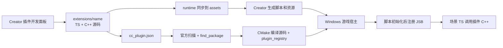

# 插件开发模式的原理与源码依据

源码核对日期：2026-10-22。**本仓库是 `cocos-plugin-dev` 工具，不是 Cocos 引擎。** 当时核对的外部引擎仓库位于 `E:/code/work/cocos4`，其 `package.json` 版本为 `4.0.0-beta.0`；实际运行验证使用本机安装的 Creator 3.8.8 及其配套引擎。

下文的 `cocos/`、`native/`、`templates/cmake/` 等源码路径，除非明确指出工具模块，均相对于外部 **Cocos 引擎仓库根目录**，不是本工具仓库内的路径。工具没有复制这些引擎文件；使用其他引擎版本时应重新核对相关接口。真实运行结果与版本组合见 [VALIDATION.md](VALIDATION.md)。

## 为什么官方教程需要先建一个游戏工程

[官方原生插件教程](https://docs.cocos.com/creator/4.0/manual/zh/advanced-topics/native-plugins/tutorial.html) 以接入预编译第三方库为例：先产生 Windows 游戏宿主，再配置原生库、胶水代码和初始化入口。这些步骤提供了插件运行所需的游戏资源、脚本虚拟机和平台窗口。

从被核对的引擎实现看，插件本身不是可启动程序：`BaseGame::init()` 加载插件入口，再启动脚本环境和游戏。单独编译一个 `.lib` 只能证明 C++ 编译成功，不能验证 TS 绑定、场景、GPU 和模型调度。

因此优化方向是复用当前游戏作为开发宿主，把重复配置自动化。工作台可以一直保留在一个游戏里，多次创建、启停和调试插件；独立沙盒只是首次验证时的一种选择。

## 被核对引擎中的发现、编译与加载



| 配置或阶段 | 外部引擎源码依据 | 对开发流程的意义 |
| --- | --- | --- |
| 搜索 `native`、`extensions`、附加 `CC_PLUGIN_PATH` | `templates/cmake/common.cmake` 的 `cc_gen_plugin_cmake_hook()` | 插件可以直接放在项目扩展目录，不需要加进引擎源码清单。 |
| 清单的 `disabled`、`platforms`、`engine-version` | `native/cmake/scripts/plugins_parser.js` | 启停和平台过滤发生在配置阶段；当前实现对可解析但不匹配的引擎版本只警告，不保证阻止加载。 |
| 平台包 `<target>-config.cmake` | 同一解析器生成 `<target>_ROOT` 和 `find_package()` | 配置可以导入预编译库，也可以 `add_subdirectory()` 编译开发源码。 |
| `module-type` | 解析器只自动加载未设置此字段或值为 `release` 的插件 | 不能为了命名“开发模式”就填 `development`，否则会跳过自动扫描。生成模板省略此字段。 |
| `plugin_registry` | `templates/cmake/common.cmake` 的 `cc_plugin_entry()` | 自动生成并调用 `cc_load_plugin_<target>()`，链接进入宿主。 |
| 原生入口 | `native/cocos/plugins/Plugins.h`、`native/cocos/application/BaseGame.cpp` | `CC_PLUGIN_ENTRY` 第一个参数必须与 `modules[].target` 及 CMake target 相同。 |
| JSB 注册时机 | `native/cocos/bindings/jswrapper/v8/ScriptEngine.cpp` | 在 `AFTER_INIT` 回调里加入注册函数，让脚本引擎正常执行注册；模板使用当前 `engine/EngineEvents.h`。 |
| C++ 运行时依赖 | 插件目标链接 `${ENGINE_NAME}` | 继承引擎公开的头文件与宏，避免维护第二份不一致的 include/define 列表。 |

生成的扫描文件在被核对引擎中拼作 `Pre-AutoLoadPlulgins.cmake`。它属于官方构建输出，工作台不手工维护它。`SKIP_SCAN_PLUGINS` 只跳过生成，随后仍会包含已有 Pre 钩子，因此不能拿它充当插件启停按钮。

## 工作台新增的部分

以下路径属于本工具仓库。`lib/core.cjs` 生成源码和清单，`templates/common/editor/plugin-support.cjs` 同步运行时资产、记录文件内容指纹、保留已有 UUID，并管理 TS/原生统一启停。目标资产出现手工修改时会报出冲突，不直接覆盖。发布包自带编辑器同步入口，因此使用者不必安装整套开发工作台。

`lib/windows.cjs` 负责工具探测、官方宿主准备、独立 CMake 缓存和调试工作区。C++ 直接编译游戏项目的 `extensions/<name>/native/src`，修改后可增量编译；TS、启停和资产变化需要先重新生成脚本资源。构建中再次修改的内容不会被当成已经构建完成。

`main.js` 和 `panels/default` 提供 Creator 扩展入口与面板。耗时操作返回任务编号，面板按编号读取日志，避免一次编辑器消息等待整个引擎编译。CLI 复用相同核心函数，便于复现故障和自动化。

工具不依赖自己位于引擎仓库内。没有显式配置引擎时，编辑器面板读取当前 Creator 使用的引擎信息；已有用户配置保持优先。编辑器内准备资源会核对 JS 和原生引擎路径，再调用当前构建服务。CLI 独立准备资源时则启动指定 Creator，工作目录设为游戏项目。两种入口都验证生成的宿主配置，避免把某套引擎的脚本与另一套 C++ 混合。

原生编译产物保存在 `.plugin-dev/build/windows`，不改写引擎目录已有的 Android 编译数据库。插件源码可以进入 Git；本机状态目录自行忽略。工作台不会向用户的 `.vscode` 写入配置。

## clangd、LLVM 与 Windows 编译器的关系

clangd 是 C++ 语言服务，负责补全、跳转、诊断；它并不决定游戏由谁编译。CMake 组织目标和参数，Ninja 执行增量构建。Windows 默认用 MSVC，另提供 clang-cl 选项；两者都需要相应 Windows SDK/MSVC 环境，现有第三方库也必须 ABI 兼容。

本工作台从真实 CMake 生成 `compile_commands.json`，再让 clangd 使用它。这样插件和引擎看到的宏、平台、头文件路径一致。TS 则由 Creator 负责导入与打包，不能用普通 `tsc` 输出直接替代项目资源管线。

## 对外部引擎渲染指南的核对

这里指历史源工作区 `E:/code/work/cocos4/docs/rendering-extension-guide.md`，该文件不随本工具仓库分发。原文三层模型以及 TS Builder 声明图、C++ 执行图的主线可以保留，以下内容需要更新或收紧：

| 原文内容 | 当前结论 |
| --- | --- |
| 版本为 `4.0.0-alpha.29` | 被核对的外部引擎版本为 `4.0.0-beta.0`。版本差异要和实测版本分开记录。 |
| C++ 扩展通常要 fork 引擎、增 `native/CMakeLists.txt`、写 SWIG | 项目原生插件已经可以链接引擎、用 sebind 暴露接口、注册公开的 Custom Pass；只有改变引擎内部契约时才需要 fork。 |
| `setCustomBehavior` 的 TS 接口尚未声明 | 当前 `cocos/rendering/custom/pipeline.ts` 的 `RenderNode` 已声明该方法。 |
| `POST_INIT` 为推荐生命周期 | 兼容代码仍在，但 `ScriptEngine.cpp` 明确标记自 3.7.0 弃用；新模板使用 `cc::events::ScriptEngine` 的 `AFTER_INIT`。 |
| 用 `Factory::createPipeline()` 取得管线 | 该函数可能创建实例且要求渲染模块存在。插件应在游戏初始化后，通过 `Root::getCustomPipeline()` 获取正在使用的管线。 |
| compute 示例可直接使用 | `ComputePassBuilder.addTexture` 当前参数是 `(name, slotName, sampler?, plane?)`，示例的数字访问参数不匹配；资源、材质和输出生产步骤也没有齐全，不能当可执行范例。 |
| 注册了 Custom Pass 就等于已接入画面 | 注册只是名字到回调的映射，还需 Builder 挂名、资源依赖、可执行节点和有效输出。空回调不能作为输出纹理生产者。 |

`NativePipeline::addCustomComputePass()` 当前用 `emplace`，同名注册不会覆盖旧实现。模板使用带插件名的行为名称，并检查当前管线实例的注册表；没有用全局布尔值假定管线永远不重建。

## 神经网络渲染插件从哪里继续

首版 `render` 模板完成 TS → JSB → 原生管线注册，提供执行计数，但没有推理模型或输出图像。后续在插件内部增加以下结构即可，不必先改整个引擎：

```text
runtime/
  index.ts                    稳定的 TS API 与开关
  neural-pipeline.ts          与项目选定的 PipelineBuilder 协作
native/src/
  PluginEntry.cpp             JSB 和生命周期
  RenderProbe.cpp            替换为实际自定义 Pass
  inference/                 模型、张量布局、后端生命周期
  resources/                 输入输出格式、历史帧和重建逻辑
native/windows/
  <target>-config.cmake       源码或第三方推理库导入
```

先定义一项可验证的运算，再接 GPU 资源：输入颜色/深度/运动矢量的格式与尺寸、输出格式、色彩空间、历史状态、后端失败回退。图里必须声明读写关系，实际回调必须完成输出后才能让后续节点采样。分辨率变化、相机切换和设备重建应释放或重建对应状态。

被核对引擎的 Vulkan `CommandBuffer::customCommand()` 会把原生命令缓冲传给回调，但这不自动解决外部推理库的设备、队列、屏障或资源所有权。需要根据所选后端另做互操作验证。首版保留游戏原有渲染路径，适合作为学习、调试和后续实现的起点。
