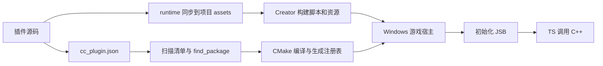

# 架构

工作台将 Creator 编辑器扩展、运行时 TS 和原生 C++ 组织为一个插件包，并使用当前游戏作为运行与调试宿主。原生编译和加载沿用 [Cocos 官方插件机制](https://docs.cocos.com/creator/4.0/manual/zh/advanced-topics/native-plugins/tutorial.html)。

## 构建与加载

| 配置或阶段 | 职责 |
| --- | --- |
| `package.json` | 声明编辑器入口，加载运行时源码同步模块。 |
| `plugin-dev.json` | 保存插件名称、模板和启用配置。 |
| `cc_plugin.json` | 声明原生模块、目标平台和启用状态，供官方构建扫描。 |
| `<target>-config.cmake` | 通过 `add_subdirectory()` 编译插件源码，也可用于引入第三方库。 |
| `${ENGINE_NAME}` | 插件链接引擎目标，继承公开的头文件路径与编译定义。 |
| `plugin_registry` | 生成对 `cc_load_plugin_<target>()` 的调用，将插件入口链接进宿主。 |
| `CC_PLUGIN_ENTRY` | 定义原生初始化入口；首参数必须与 `modules[].target` 和 CMake target 一致。 |
| `AFTER_INIT` | 脚本引擎初始化后注册 JSB，随后游戏 TS 才能使用原生接口。 |

原生插件静态链接到游戏。启停会同时更新 TS 开关和原生清单，需要重新配置、构建并重启游戏后生效。编辑器扩展的卸载不等于卸载游戏中的原生代码。

相关引擎实现位于 `templates/cmake/common.cmake`、`native/cmake/scripts/plugins_parser.js`、`native/cocos/plugins/Plugins.h` 和 `native/cocos/application/BaseGame.cpp`。这些路径相对于 **Cocos 引擎仓库**；引擎源码不包含在本工具仓库中。

## 工具模块

| 模块 | 职责 |
| --- | --- |
| `main.js`、`panels/default/` | 编辑器菜单、面板、任务状态与日志。 |
| `cli.cjs` | 与面板共用核心函数的命令行入口。 |
| `lib/core.cjs` | 生成插件、安装工作台、管理插件和打包。 |
| `lib/windows.cjs` | 探测工具链、准备宿主、配置与构建 C++、生成调试工作区。 |
| `templates/common/editor/plugin-support.cjs` | 同步运行时文件、检测冲突、记录变更和启停状态；随生成的插件分发。 |

耗时操作先返回任务编号，面板再读取日志和完成状态。面板在原生构建期间禁用其他写入操作。构建过程中发生的新修改保留为待构建状态。

取消请求通过 `AbortSignal` 传递到构建流程。任务在子进程退出前保持锁定，取消完成后才恢复操作。Creator 编辑器内的资源构建等待当前阶段结束后停止后续步骤。

游戏进程按项目记录 PID、启动时间和可执行文件路径，停止前重新核对身份。运行、停止和重启使用跨进程锁；构建前停止工具管理的游戏实例。其他工具启动的进程不由工作台接管。

## 源码与构建状态

插件的编辑入口是 `extensions/<name>/runtime` 和 `native/src`。运行时 TS 自动同步到 `assets/__plugin_dev/<name>`，由 Creator 导入和打包。同步保留已有 `.meta` 和 UUID；目标文件被手动修改时报告冲突。

C++ 直接参与宿主的 CMake 构建，无需先生成库再复制到项目。新增源文件需加入插件的 `CMakeLists.txt`。只修改 C++ 时执行增量编译；TS、启停和资源变化需要更新 Creator 构建资源。

本机配置、文件指纹、日志及构建缓存保存在项目 `.plugin-dev` 中，独立于插件源码。原生缓存使用 `.plugin-dev/build/windows`，调试配置写入独立工作区，不覆盖项目的 `.vscode`。

## 引擎与工具链

游戏项目、工具和引擎可以放在独立目录。面板优先使用已保存的引擎配置；未配置时读取当前 Creator 的引擎信息。准备资源前检查 JS 与原生引擎路径，确保脚本资源和 C++ 使用同一套引擎。

编辑器内准备资源使用当前 Creator 的构建服务；CLI 则启动指定 Creator，并以游戏项目为工作目录。`builder/add-task` 属于版本相关接口，不兼容时会报告错误并提供 CLI 回退步骤。

CMake 管理目标与编译参数，Ninja 执行增量构建。Windows 默认使用 MSVC，也支持 clang-cl；二者均需要匹配的 Windows SDK、MSVC 工具集和第三方库 ABI。clangd 使用 CMake 生成的 `compile_commands.json` 提供代码分析，不参与插件加载。

C++ 和游戏 TS 使用两套调试会话，分别连接原生调试器和 V8 Inspector。TS 源码断点依赖 source map；工具不提供跨语言统一单步或 DLL 热替换。

## 渲染扩展

`render` 模板提供 TS → JSB → Custom Pass 注册入口和执行计数。注册只是建立行为名称到原生回调的映射，项目仍需通过 `PipelineBuilder` 添加图节点、声明资源读写并产出有效结果。

渲染插件应在管线创建后获取当前管线，按管线实例管理注册状态。输入输出尺寸或设备状态变化时，需要重建相应资源。空回调不能作为输出纹理的生产者。

模板不包含神经网络模型、推理后端或 GPU 图像处理。接入推理库时，需要明确模型生命周期、张量与纹理格式、设备和队列同步、历史帧资源及失败回退。RenderGraph 的依赖声明不会自动处理外部推理库内部的同步。
